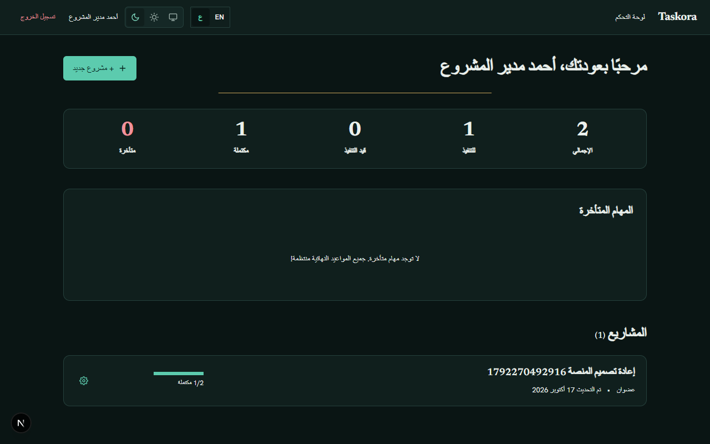
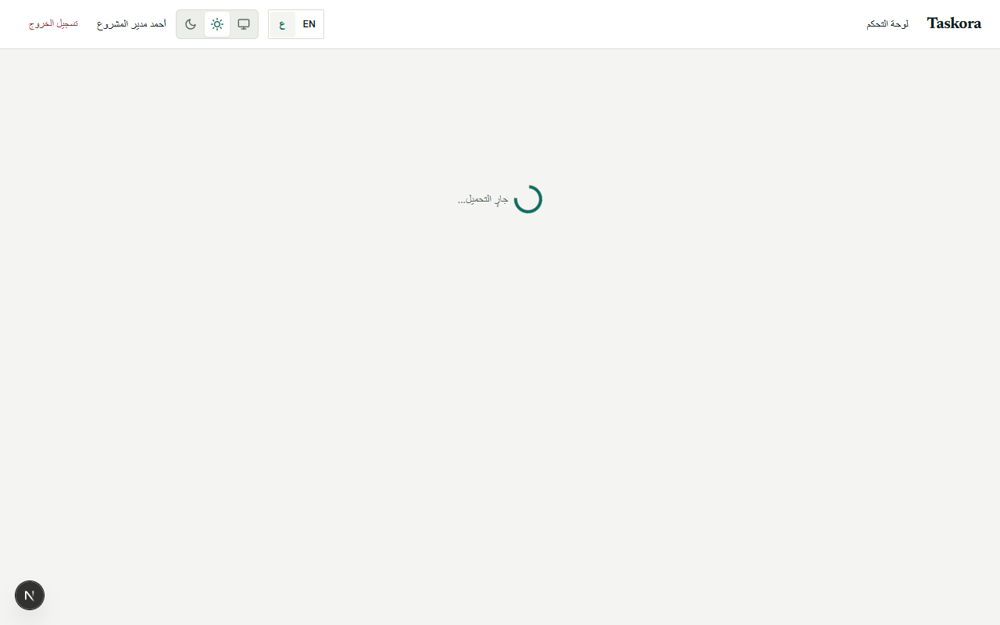
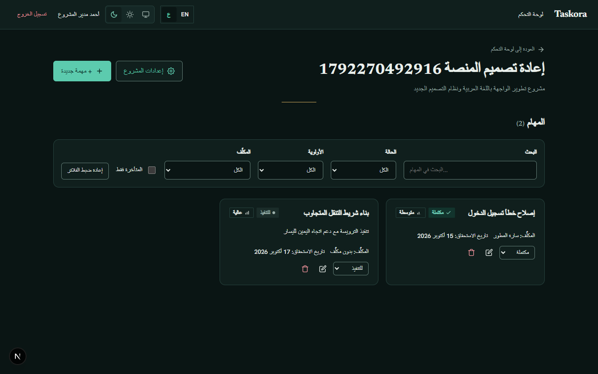
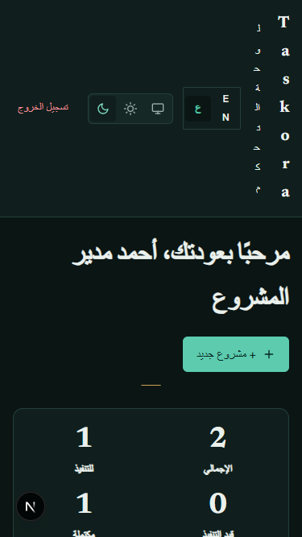
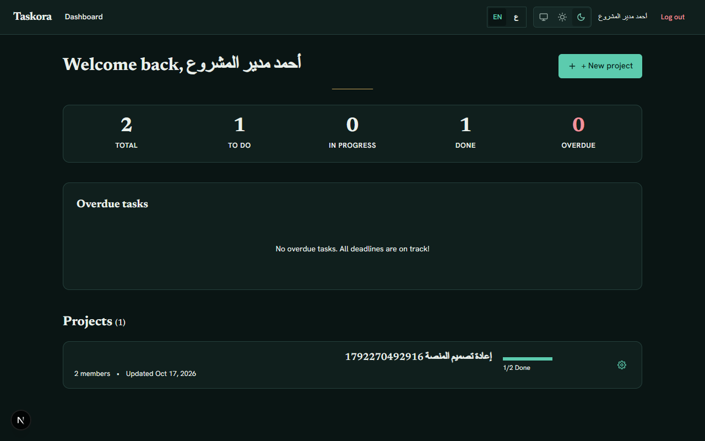
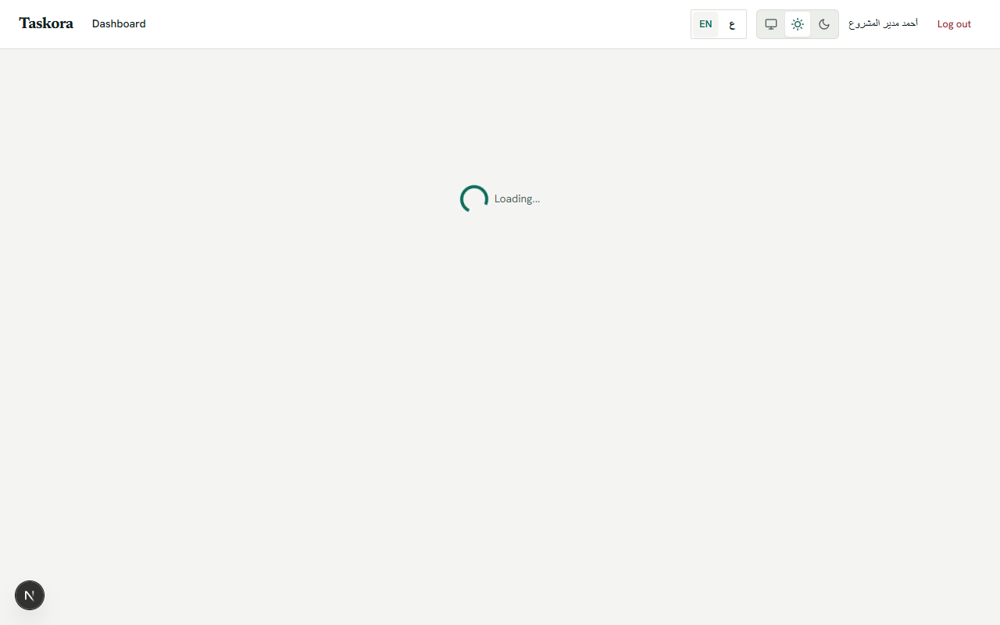

# TaskFlow — Collaborative Project & Task Management

TaskFlow is a collaborative project and task management system designed for small teams, built with Next.js App Router, Firebase Modular SDK (Auth & Firestore), CSS Modules with CSS Logical Properties (strictly zero Tailwind CSS), full Arabic/English internationalization, and an editorial dark/light theme system.

---

## Deployment & Repository
- **Live Production URL**: [https://taskora-eta-flame.vercel.app](https://taskora-eta-flame.vercel.app)
- **GitHub Repository**: [https://github.com/Abdelrhman-Naim/Taskora](https://github.com/Abdelrhman-Naim/Taskora)
- **Firebase Project ID**: `taskora-bf729` (Cloud Firestore & Auth enabled)
- **Deployment Platform**: Vercel

---

## Features

### Internationalization & RTL (Phase 2)
- **Full Bilingual Support**: First-class Arabic (`ar`, RTL) and English (`en`, LTR) localization with Arabic as default.
- **Content Negotiation & Zero Flash**: Server-side language negotiation via `tf-locale` cookie and `Accept-Language` header; inline blocking script prevents any flash of wrong direction or language.
- **RTL-Native Layout**: Strict adherence to CSS Logical Properties (`margin-inline`, `padding-block`, `inset-inline-start`, etc.) with mirrored direction-sensitive SVG icons (`scaleX(-1)` for back arrow) and progress bars filling from right in Arabic.
- **Bidi Text Preservation**: All user-generated content (project names, task descriptions, titles) uses `dir="auto"` to preserve native text flow; email addresses and dates are strictly isolated with `dir="ltr"`.
- **Latin Numerals Consistency**: Both locales render Latin numerals (0-9) consistently for numbers, dates, and times (`APP_LOCALE_NUMBER_FORMAT = 'en-US'`).

### Theming & Design System (Phase 2)
- **Editorial Design System**: Bespoke aesthetic featuring warm parchment/cream surfaces in light mode, deep bronze/charcoal surfaces in dark mode, and warm brass accents (`#c29b38` light / `#e5c158` dark).
- **Zero-Flash Theme Switching**: Instant switching between Light, Dark, and System modes with cookie persistence (`tf-theme`) and zero flash of unstyled theme (FOUT).
- **Primitive UI Library**: 10 hand-crafted, accessible primitives in `src/components/ui/` (Button, Input, Textarea, Select, Badge, Dialog, Spinner, EmptyState, ErrorState, Icon) with full keyboard accessibility (visible focus ring, ESC to dismiss modals).
- **Interactive Design Showcase**: Live interactive design system catalog accessible at `/design-system` and documented in `docs/design-system.md`.

### Core Application (Phase 1)
- **Authentication**: Email & password signup, login, persistent session across reloads, and automatic route protection (`/dashboard` redirects unauthenticated users to `/login`).
- **Projects**: Create projects, view projects, update settings, cascade delete with atomic cleanup.
- **Membership**: Add team members via email lookup (`usersByEmail`), atomic task unassignment upon member removal, and access revocation.
- **Tasks**: Full task management with status (`todo`, `in_progress`, `done`), priority (`low`, `medium`, `high`), due dates (`YYYY-MM-DD` in `Asia/Riyadh` timezone), and assignee handling.
- **Task Permissions**: Strict security rules enforcing a granular permissions matrix across owner, creator, assignee, other members, and outsiders.
- **Search & Filters**: Real-time filtering by status, priority, assignee, search keyword (case-insensitive on task titles), and overdue tasks.
- **Dashboard**: Aggregated project statistics, status counts, and overdue task notifications.
- **Resilience & Accessibility**: Offline network failure handling (`withWriteGuard`), accessible semantic HTML and ARIA labels, responsive layouts (375px, 768px, 1280px) with zero horizontal overflow.

---

## Languages & Themes

### Cookie Persistence & Negotiation
The application manages language and theme preferences without requiring authentication:

| Cookie Name | Values | Default | Behavior |
|:---|:---|:---|:---|
| `tf-locale` | `ar`, `en` | `ar` (or `Accept-Language`) | Persists locale choice for 1 year (`SameSite=Lax`). When absent, server negotiates via `Accept-Language` header, falling back to Arabic (`ar`). |
| `tf-theme` | `light`, `dark`, `system` | `system` | Persists theme choice for 1 year (`SameSite=Lax`). An inline `<script>` in `<head>` resolves `system` to `prefers-color-scheme: dark` before DOM render to eliminate flash. |

### Adding a New Language
To add a new language (e.g. French `fr` or Spanish `es`):
1. **Create the Dictionary**: Create `src/i18n/<locale>.ts` satisfying the TypeScript `Dictionary` type and all keys in `src/i18n/en.ts`.
2. **Register the Locale**: Add `<locale>` to `SUPPORTED_LOCALES` in `src/i18n/config.ts` and specify its reading direction (`rtl` or `ltr`).
3. **Register in Provider**: Add the dictionary to the loader map in `src/i18n/I18nProvider.tsx`.
4. **Verify Parity**: Run `npm run test:unit` to execute `tests/unit/i18n-parity.test.ts`, which automatically verifies 100% key parity and absence of empty strings across all registered languages.

---

## Design System

The application is styled with custom CSS Modules and CSS Custom Properties conforming to WCAG 2.1 AA contrast requirements (body text contrast >= 4.5:1, headers and badges >= 7:1).

- **Design System Documentation**: [docs/design-system.md](docs/design-system.md)
- **Live Interactive Showcase**: Browse all components at `/design-system`

### Primitives Overview:
1. **Button**: Primary, secondary, outline, danger, and ghost variants; small, medium, and large sizes; optional leading icon; accessible disabled and loading states. Supports both `<button>` and `<Link>` behaviors.
2. **Input**: Text, email, and password inputs with label, helper text, error messages, and logical RTL text alignment.
3. **Textarea**: Auto-resizing multiline text input with character counters and accessible error states.
4. **Select**: Dropdown select with custom styled brass chevron, full keyboard navigation, and placeholder support.
5. **Badge**: Status indicators with semantic color coding (`todo`, `in_progress`, `done`, `overdue`, `low`, `medium`, `high`, `owner`, `member`).
6. **Dialog**: Accessible modal dialog with focus trapping, `Escape` key dismissal, backdrop click dismissal, and `aria-modal="true"`.
7. **Spinner**: Pure CSS animated brass loading spinner with customizable size and screen reader text.
8. **Icon**: 14 pure hand-crafted inline SVG icons (no external icon dependencies).
9. **EmptyState & ErrorState**: Standardized empty collection and failure recovery states with primary action triggers.

---

## Tech Stack
- **Framework**: Next.js 16 (App Router, Server Components & Client Components)
- **Language & Validation**: TypeScript, Zod runtime validation
- **Backend**: Firebase JS SDK (modular v13) — Authentication & Cloud Firestore
- **Styling**: CSS Modules + CSS Custom Properties + Logical Properties (Strictly zero Tailwind CSS)
- **Unit Testing**: Vitest, React Testing Library, jsdom (20 test files, 135 tests)
- **Security Testing**: `@firebase/rules-unit-testing`, Firebase Local Emulator Suite (5 test files, 46 tests)
- **Services Integration Testing**: Firebase Emulators (4 test files, 22 tests)
- **Acceptance & E2E Testing**: Playwright with Chromium (3 test suites, 18 tests)

---

## Firestore Schema & Architecture

```
/users/{uid}
  ├── email: string
  ├── displayName: string
  └── createdAt: Timestamp

/usersByEmail/{emailLower}
  ├── uid: string
  ├── email: string
  └── displayName: string

/projects/{projectId}
  ├── name: string (3..80 chars)
  ├── description: string (<= 1000 chars)
  ├── ownerId: string
  ├── memberIds: string[]
  ├── memberNames: map<uid, string>
  ├── createdAt: Timestamp
  └── updatedAt: Timestamp
  └── /tasks/{taskId}
        ├── title: string (3..120 chars)
        ├── description: string (<= 1000 chars)
        ├── status: 'todo' | 'in_progress' | 'done'
        ├── priority: 'low' | 'medium' | 'high'
        ├── assigneeId: string | null (must be in project.memberIds)
        ├── createdBy: string
        ├── dueDate: string (YYYY-MM-DD) | null
        ├── createdAt: Timestamp
        └── updatedAt: Timestamp
```

---

## Test Evidence & Automated Test Matrix

The test suite contains **221 automated tests** covering security rules, service integration, unit components, i18n parity, responsive layouts, and end-to-end user journeys:

| Test Suite | Files | Tests Passing | Environment |
|:---|:---:|:---:|:---|
| **Unit Tests** | 20 | **135** | Vitest + React Testing Library + jsdom |
| **Firestore Security Rules** | 5 | **46** | Vitest + `@firebase/rules-unit-testing` + Local Emulators |
| **Service Integration Tests** | 4 | **22** | Vitest + Local Auth & Firestore Emulators |
| **Acceptance & E2E Tests** | 3 | **18** | Playwright (Phase 1 Acceptance TC-01..16 + Phase 2 i18n/theme/RTL + Screenshots) |
| **Total** | **32 files** | **221 tests** | **100% PASS** |

### Acceptance Test Cases (TC-01…TC-16)
- **TC-01**: User registration, displayName, and profile mapping (**PASS**)
- **TC-02**: Validation errors on invalid email and short password (**PASS**)
- **TC-03**: User login and persistent session across page reloads (**PASS**)
- **TC-04**: Unauthenticated user redirected to `/login` (**PASS**)
- **TC-05**: Project creation and persistence across browser reload (**PASS**)
- **TC-06**: Project access control (owner/member read, outsider denied) (**PASS**)
- **TC-07**: Owner adds member by email (case/whitespace normalized) (**PASS**)
- **TC-08**: Unregistered email rejected with clear error (**PASS**)
- **TC-09**: Task creation with default status=todo and timestamps (**PASS**)
- **TC-10**: Assignee can update status; non-assignee denied (**PASS**)
- **TC-11**: Filter tasks by priority, status, assignee, and overdue (**PASS**)
- **TC-12**: Search tasks by title (case-insensitive, trimmed) (**PASS**)
- **TC-13**: Access control on outsider project and not-found project (**PASS**)
- **TC-14**: Member removal unassigns tasks atomically and revokes access (**PASS**)
- **TC-15**: Responsive layout without horizontal overflow at 375, 768, 1280px (**PASS**)
- **TC-16**: Offline resilience: graceful error display within <= 10s (**PASS**)

---

## Permissions Matrix

Enforced strictly in `firestore.rules` and reflected in UI conditional rendering:

| Action | Owner | Task Creator | Task Assignee | Project Member | Outsider |
|:---|:---:|:---:|:---:|:---:|:---:|
| Read Project & Tasks | Yes | Yes | Yes | Yes | Denied |
| Update Project / Delete Project | Yes | Denied | Denied | Denied | Denied |
| Add / Remove Members | Yes | Denied | Denied | Denied | Denied |
| Create Task | Yes | Yes | Yes | Yes | Denied |
| Edit Task Title / Description / Due Date | Yes | Yes | Denied | Denied | Denied |
| Update Task Status (`todo` / `in_progress` / `done`) | Yes | If Assigned | Yes | Denied | Denied |
| Delete Task | Yes | Yes | Denied | Denied | Denied |

---

## Product Screenshots

### Arabic (RTL) — Dark & Light Themes
| Arabic Dark Dashboard | Arabic Light Dashboard |
|:---:|:---:|
|  |  |

| Arabic Project View (RTL Tasks & Progress Bar) | Arabic Mobile View (375px) |
|:---:|:---:|
|  |  |

### English (LTR) — Dark & Light Themes
| English Dark Dashboard | English Light Dashboard |
|:---:|:---:|
|  |  |

---

## Local Development & Testing

### Prerequisites:
- **Node.js**: v20.x, v22.x or v24.x
- **Java**: Java 21+ (required for Firebase Local Emulator Suite)

```bash
# 1. Install dependencies
npm install

# 2. Typecheck & Lint
npm run typecheck
npm run lint

# 3. Unit, Security Rules & Service Tests (203 tests)
npm run test:unit
npm run test:rules
npm run test:services

# 4. Full E2E & Visual Matrix (Playwright against emulators)
npm run test:e2e

# 5. Production Build
npm run build
```
