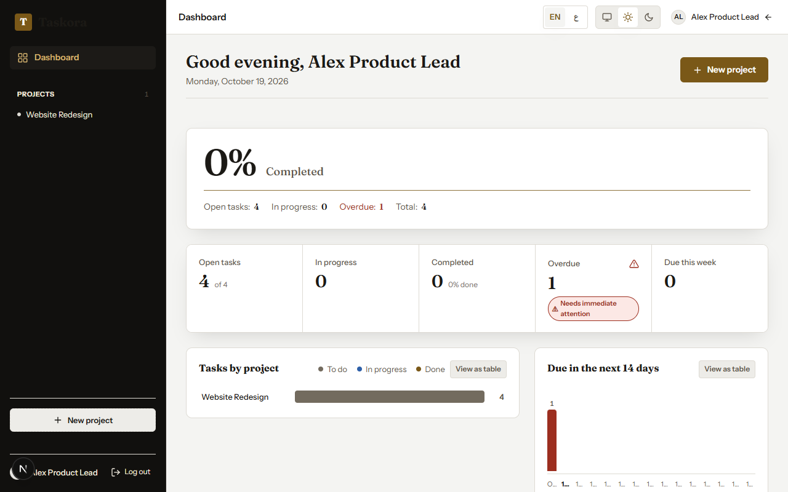
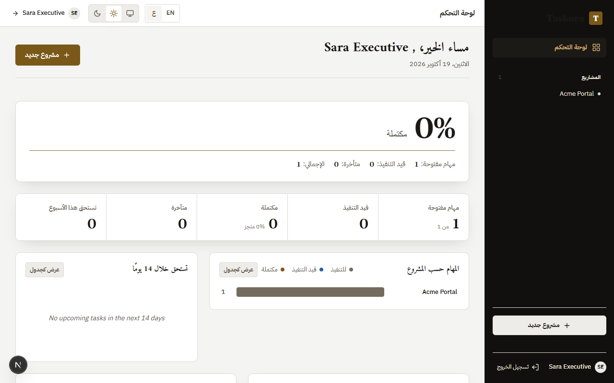
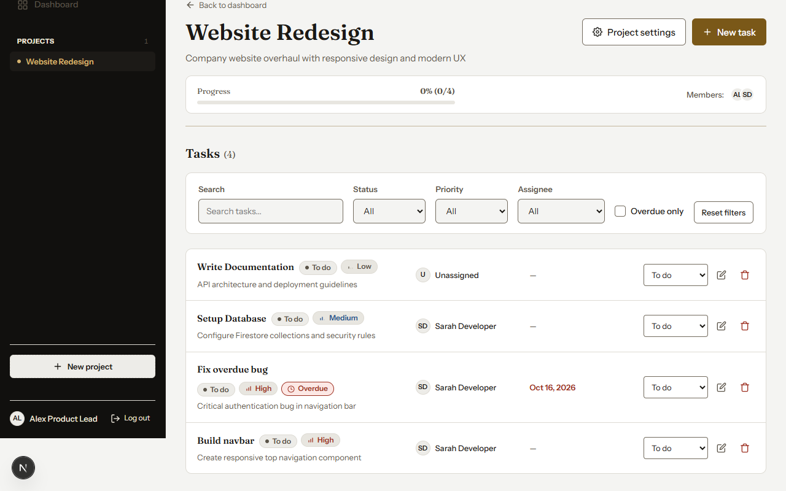
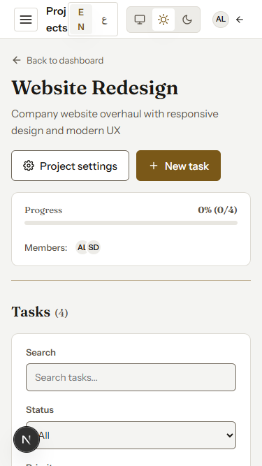

# Taskora (TaskFlow) — Collaborative Project & Task Management

Taskora is an executive-grade, bilingual collaborative project and task management system built with Next.js 16 (Turbopack, App Router), React 19, Firebase Modular SDK (Authentication & Cloud Firestore), and pure CSS Modules with CSS Logical Properties (strictly zero Tailwind CSS in application code).

The visual aesthetic and layout architecture are designed under the **"Obsidian Ledger"** design system, created and verified through the **Google Stitch MCP Design Workflow** and evaluated against a **17-point design rubric**, guaranteeing WCAG 2.1 AA accessibility, seamless English/Arabic bidirectional parity, zero horizontal overflow across all viewports (320px–1280px+), and complete dark/light mode consistency.

---

## Live Deployment & Repository
- **Production URL**: [https://taskora-eta-flame.vercel.app](https://taskora-eta-flame.vercel.app)
- **GitHub Repository**: [https://github.com/Abdelrhman-Naim/Taskora](https://github.com/Abdelrhman-Naim/Taskora)
- **Firebase Project ID**: `taskora-bf729` (Cloud Firestore & Auth enabled)
- **Deployment Platform**: Vercel

---

## Visual Previews

| Light Mode (LTR / Desktop 1280px) | Dark Mode (RTL / Arabic 1280px) |
|---|---|
|  |  |

| Task Board & Filtering | Mobile Responsive (375px) |
|---|---|
|  |  |

Detailed before/after comparison and design evolution are documented in [docs/design/v2/before-after.md](docs/design/v2/before-after.md).

---

## Design System: Obsidian Ledger

Taskora v2 replaces generic SaaS card templates with an editorial **financial ledger** paradigm:

### 1. Architectural Principles
- **Ledger Rows, Not Card Soup:** Projects and tasks are rendered as continuous ledger sheets separated by architectural hairlines (`#2C2824` in dark, `#DDDAD3` in light), restricting elevated panels to a maximum of two per screen.
- **Hero Numeral:** A single grand completion percentage metric in high-contrast Fraunces serif underlined with a quiet champagne rule anchors the dashboard.
- **Strict Accent Rationing:** Champagne (`#D4B26E` dark / `#7A5818` light) is strictly rationed to exactly three touchpoints: the primary action button, the 1px active navigation indicator rule, and single-series chart emphasis.
- **Persistent Obsidian Sidebar:** The docked sidebar remains near-black (`#11100E`) across both Dark and Light modes for consistent executive anchoring.
- **Zero Phantom Features:** No generic command palettes (Cmd+K), simulated notifications, or ungrounded upsell widgets; every control binds directly to Firestore data contracts.

### 2. Typographic Palette
- **Headings & KPI Figures:** **Fraunces** variable display serif with `font-variant-numeric: lining-nums tabular-nums`.
- **Interface & Body:** **Instrument Sans** clean modern sans-serif.
- **Arabic Display:** **Amiri** classical serif.
- **Arabic Body:** **IBM Plex Sans Arabic** with Latin numerals (`latn`) for tabular alignment.

### 3. Palette Tokens
| Token | Dark (Obsidian) | Light (Pearl & Bronze) | Purpose |
|---|---|---|---|
| `--bg` | `#0C0B0A` | `#F4F4F2` | Base canvas background |
| `--surface` | `#141211` | `#FFFFFF` | Primary surface container |
| `--surface-raised` | `#1C1A17` | `#FFFFFF` | Elevated dialogs and menus |
| `--line` | `#2C2824` | `#DDDAD3` | Hairline ledger row dividers |
| `--text` | `#EFE9DD` | `#1B1915` | High-contrast primary reading text |
| `--accent` | `#D4B26E` | `#7A5818` | Champagne / Bronze focal accent |
| `--sidebar-bg` | `#11100E` | `#11100E` | Persistent dark sidebar plane |

---

## Google Stitch MCP Design Integration

The visual system was generated, frozen, and verified via the **Google Stitch MCP**:
- **Stitch v2 Project ID**: `1925018263022126574` (`Taskora v2 — Obsidian Ledger`)
- **Design System Asset**: `assets/740bfefb8f9e46d4af43ed2ce7b44189`
- **Frozen Visual Assets**: Archived under `docs/design/v2/stitch/` (Desktop PNG, Mobile PNG, and reference HTML for every view: Dashboard, Login, Register, Project, Project Settings, New Project, and UI States).
- **17-Point Rubric**: Evaluated against `docs/design/RUBRIC.md` including ledger row structure (criterion 16) and display tabular numerals (criterion 17).

---

## Key Features

### 1. Application Shell & Navigation
- **Docked Sidebar (Desktop ≥ 1024px):** Fixed navigation with Taskora logo, project counters, and user profile card.
- **Responsive Drawer (Mobile < 1024px):** Accessible slide-out dialog (`role="dialog"`, `aria-modal="true"`) with backdrop dismissal, focus trap, and `Escape` key handling.
- **Sticky TopBar:** Context title, Language Switcher, Theme Switcher, and User Profile Menu with avatar and sign-out trigger.

### 2. Executive Dashboard & Metrics
- **Single Hero Numeral:** Live percentage completion rate with hairline rule and ledger metric strip.
- **Accessible HTML/CSS Charts:**
  - **Stacked Bars:** Status breakdown per project with keyboard focus tooltips and an accessible `<table>` alternative toggle.
  - **14-Day Timeline (Column Chart):** Workload timeline highlighting today's deadline and alerting on overdue tasks.
- **Attention Widgets:** "Needs Attention" queue prioritizing overdue and impending tasks, "My Tasks" personalized list, and sortable Projects Ledger table.

### 3. Project & Task Management
- **Project Detail View:** Progress summary, team member avatars, status filtering, and keyword search.
- **Task Management Modal:** Modal dialog for creating and updating tasks with validation, priority selection, assignee allocation, and due date picking.
- **Permission-Aware Controls:** Enforces ownership rules (only creators or project owners can delete tasks; only assignees can mark tasks completed).
- **Project Settings:** Project metadata updates, owner transfer guards, and atomic member invitation/removal with task reassignment cascades.

### 4. Internationalization & Bidirectional Safety
- **Bilingual Parity:** English (`en`, LTR) and Arabic (`ar`, RTL) with 100% key parity across translation dictionaries.
- **Bidirectional Isolation (`<bdi>`):** User-generated text (names, titles, notes) is strictly wrapped in `<bdi dir="auto">` to eliminate bidirectional text spillover.
- **Latin Numerals:** Consistent Latin numbering (`latn`) across Arabic and English for clear data scanning in tables and KPIs.
- **Timezone Safety:** Native `Intl.DateTimeFormat` configured with `Asia/Riyadh` timezone to prevent server/client hydration drift.

### 5. UI Primitives Library (`src/components/ui/`)
21 hand-crafted, accessible primitives built strictly with CSS Modules and CSS Logical Properties:
`Avatar`, `Badge`, `Button`, `Card`, `Checkbox`, `ConfirmDialog`, `Dialog`, `EmptyState`, `ErrorState`, `Field`, `Icon`, `IconButton`, `Input`, `LocaleSwitcher`, `ProgressBar`, `Segmented`, `Select`, `Skeleton`, `Spinner`, `Textarea`, `Toast`.

---

## Automated Test Matrix & Safety Guards

The project enforces continuous code quality via automated static analysis, unit tests, security rules emulators, and Playwright visual baselines:

| Test Suite | Files | Tests Passing | Test Framework / Environment |
|:---|:---:|:---:|:---|
| **Unit Tests & Static Integrity** | 32 | **217** | Vitest + React Testing Library + jsdom |
| **Firestore Security Rules** | 5 | **46** | Vitest + `@firebase/rules-unit-testing` + Local Firestore Emulator |
| **Service Integration Tests** | 4 | **22** | Vitest + Local Auth & Firestore Emulators |
| **Playwright E2E & Matrix** | 8 | **53** | Playwright (20 combos: LTR/RTL × Light/Dark × 3 Viewports + Acceptance) |
| **Total Test Count** | **49 files** | **338 tests** | **100% PASS** |

### Automated Guards:
- **`no-legacy-palette.test.ts`**: Fails if any legacy color (`#0d5c5a`, `#13966F`, `#22A67F`), legacy font (`Inter`, `Geist`, `Newsreader`), or legacy naming exists.
- **`css-integrity.test.ts`**: Verifies every `var(--*)` exists in `tokens.css` and ensures zero hardcoded color literals exist outside `tokens.css`.
- **`tokens-contrast.test.ts`**: Mathematically computes WCAG 2.1 relative luminance ratios for all tokens in both themes.
- **`i18n-hygiene.test.ts`**: Enforces zero untranslated English strings in Arabic attributes, verified `<bdi>` wrapping, and zero decorative symbol prefixes.
- **`visual.spec.ts`**: Validates zero horizontal overflow on all pages from 375px to 1280px, checks RTL sidebar right-alignment, and runs Axe-core accessibility audits with zero violations.

---

## Local Development & Testing

### Prerequisites:
- **Node.js**: v20.x, v22.x or v24.x
- **Java**: Java 21+ (required for Firebase Local Emulator Suite)

```bash
# 1. Install dependencies
npm install

# 2. Typecheck & Lint
npm run typecheck
npm run lint

# 3. Unit, Integrity & Safety Tests (217 tests)
npm run test:unit

# 4. Security Rules Tests (46 tests)
npm run test:rules

# 5. Service Integration Tests (22 tests)
npm run test:services

# 6. Playwright Visual Baselines & E2E Suites (53 tests)
npm run test:e2e

# 7. Production Build (Next.js Turbopack)
npm run build
```
